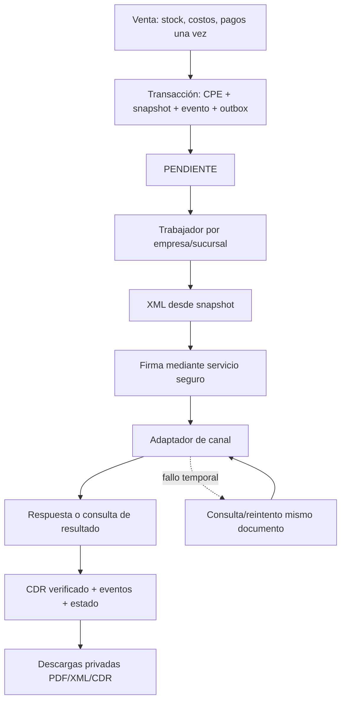

# EDUXFAC WEB — Fase 1 de facturación electrónica

Fecha: 16/10/2026, America/Lima. Versión local: 44.4.0.

**Auditoría y diseño terminados. GO técnico para una Fase 2 aislada de modelo, clientes fiscales y numeración. NO-GO para emisión real o despliegue. No se inició Fase 2.**

Raíz exclusiva: `D:\EDUXFAC\EDUXFAC WEB\01_TRABAJO_ACTUAL\EDUXFAC_WEB_ACTUAL`.

Solo se leyeron fuentes, esquemas, migraciones y contratos de pruebas; solo se agregaron documentos en esta carpeta. No se inició aplicación, PostgreSQL, trabajadores ni servicios; no se importó app.js ni se ejecutaron migraciones. No hubo acceso a BD/datos PILOTO ni servicios operativos SUNAT/PSE/OSE. Solo se consultó documentación pública SUNAT. Escritorio, PANEL, VPS, Nginx e instalación comercial quedaron fuera de las operaciones realizadas.

El esquema descrito es el declarado por las fuentes locales, no una certificación de la BD efectiva del VPS. El adjunto no contiene las capturas RAPIFAC: se usa la lista escrita de flujos, sin afirmar comparación visual ni copiar marca/diseño/código.

## 1. Orden actual

Selector ORDEN, valor inicial en Ventas (`public/index.html:679–687`, `setSaleDocumentType:1772`). Es una **venta interna cobrada**, no una orden pendiente independiente. `checkout:1776` envía productos/cliente/pagos a `POST /api/sales` (`server/src/app.js:419`). Ese handler registra cabecera, detalles, pagos, inventario, caja si hay sesión y auditoría en una transacción.

Tablas comunes: ventas, venta_detalles, venta_pagos, lotes, movimientos_inventario, movimientos_caja, auditoria; relaciones con empresa/sucursal/usuario/cliente/sesión. Cliente opcional. Pagos deben sumar el total; este handler permite venta sin sesión de caja. Participa en reportes netos y devoluciones/anulaciones comunes.

`showReceipt:1190` imprime DOCUMENTO INTERNO, usa `documentos_config.orden`, anchos58/80/A4 y serie/número si existen o primeros8 caracteres del UUID. No hay recuperación de borrador ni conversión idempotente. `ordenes_compra` y `orden_compra_detalles` son de compras: no reutilizarlas para una orden de venta.

Objetivo futuro: conservar la orden interna ya cobrada; si se autorizan órdenes pendientes, darles ciclo separado hasta conversión explícita, sin reinterpretar históricos.

## 2. Boleta actual

Selector BOLETA, mismo checkout, endpoint, tablas, pago, stock, impresión y devoluciones que ORDEN. Cliente opcional en UI, sin regla por importe. Servidor solo verifica que el cliente enviado sea activo y de la empresa; no impone identidad fiscal por tipo/monto.

Cambia título/configuración de impresión a BOLETA DE VENTA. `isFiscal` en impresión solo omite DOCUMENTO INTERNO: **no acredita emisión electrónica**. No hay XML, firma, CDR, estado electrónico ni resumen diario. Los reportes la tratan como venta mediante tipo_comprobante.

## 3. Factura actual

Selector FACTURA, mismo flujo operativo. `selectSaleClient:1304` exige 11 dígitos al seleccionar cliente; no exige tipo_doc=RUC ni dígito de control. Checkout exige cliente seleccionado. Nombre/razón social usa `clientes.nombres`.

**El servidor no reproduce esa validación fiscal.** `/api/sales` admite FACTURA sin cliente y no contiene un enum de tipos permitidos. No verifica razón social, ubigeo, moneda, fecha de emisión o desglose de impuestos fiscal. Una llamada directa puede saltar la restricción visual.

Se imprime título FACTURA y documento etiquetado RUC, sin XML/firma/CDR. No existe integración ni consulta SUNAT implementada. No se cambió este comportamiento.

## 4. Nota de crédito y devoluciones actuales

Existen dos mecanismos sin conexión fiscal:

| Mecanismo | Efecto actual | Brecha |
|---|---|---|
| NOTA DE CREDITO en Nueva Venta | Crea venta positiva en `/api/sales`, obliga pago y descuenta stock; imprime título de NC | Sin documento origen ni devolución: no es NC fiscal |
| Devolución/anulación | POST `/api/sales/:id/return`; GET `/returns` para historial | Repone/reembolsa, pero no genera NC ni serie/XML/CDR |

Devolución: bloquea venta FOR UPDATE, verifica empresa/sucursal, motivo y medio de reembolso. Requiere caja abierta del usuario en esa sucursal. TOTAL solo el mismo día según America/Lima. API permite cantidades parciales; UI agrupa por presentación/precio y devuelve toda cantidad pendiente de grupos seleccionados (`returnGroups`, `renderReturnItems`, `confirmReturnSale`:1693–1696).

Relaciones: devoluciones_venta.venta_id y devolucion_venta_detalles.venta_detalle_id. Controla cantidades pendientes; reembolsa con importe_neto y diferencia acumulativa redondeada, conservando residuo final. Repone unidades base al lote por `applyPositiveStockEntry` con costo histórico/factor. Genera movimiento de inventario y EGRESO si monto>0. Estado operativo pasa a DEVOLUCION_PARCIAL o ANULADA por cantidades restantes. No crea otra venta negativa.

Reportes netos restan ingresos, cantidades, costo y utilidad devueltos. Ventas netas se atribuyen a fecha de venta; caja a sesión/fecha del reembolso. Reporte Anulaciones incluye solo registros tipo TOTAL, no todas las parciales ni un libro de NC. Varias parciales pueden acabar con venta ANULADA sin un registro TOTAL.

Para NC futura: documento fiscal origen, mismo adquirente, tipo/serie/número origen, motivo codificado, detalle/tributos afectados, límites acumulados, serie FC/BC, snapshot/estado/artefactos propios. Vincular devolución si existe; otros motivos pueden no reponer stock ni devolver caja. **Emitir/reintentar NC nunca repone/reembolsa de nuevo.** Baja fiscal y anulación operativa se diseñan separadas. La restricción actual de TOTAL en el mismo día no será regla fiscal de NC.

## 5. Cotización actual

Selector COTIZACION y configuración de impresión con nota “Cotización referencial. No acredita pago”. Aun así, usa `/api/sales`, exige pagos, descuenta stock y participa en caja/reportes como venta. No tiene API/tablas propias, vigencia, estados ni conversión idempotente.

Clasificación objetivo: **documento interno**, separado de venta y CPE. Guardar sin cobrar/mover stock y convertir una sola vez. No borrar ni reclasificar automáticamente ventas históricas COTIZACION: conservar legado y conciliar en fase autorizada.

## 6. Archivos involucrados

Rutas relativas a la raíz exclusiva. Líneas vinculadas a hashes de esta auditoría.

| Archivo | Función/referencia |
|---|---|
| public/index.html | 679–694 selectores/venta;708 clientes;966 total;1015 renderCart;1190 showReceipt;1304 selección;1339 guardar cliente;1455 detalle;1691–1696 devoluciones;1772 tipo;1776 checkout; centro de reportes/configuración |
| server/src/app.js | 49 money;57 acceso sucursal;127 middleware;419 venta;472 configuración;526 compatibilidad devoluciones;544/559 historial/operación;624 receipt;921–948 clientes;1688 reporte ventas;1748 centro;1791 anulaciones; initializeDatabase al final |
| server/src/sale-profitability.js | validateSalePresentation y assertSaleProfitability: precisión/presentación/costo/rentabilidad transaccional |
| server/src/stock-cost.js; inventory-entry.js | Valorización y reposición de lotes; no duplicar efectos con emisión |
| server/src/monthly-sales.js | Ventas mensuales netas por fecha de venta Lima |
| server/src/report-document.js | readReportDocument: compras/anulaciones, solo lectura; referencias_actuales=true |
| server/src/auth.js; db.js; access-policy.js; tenant-guard.js | JWT/empresa, contexto RLS, transacciones, permisos y pertenencia |
| server/scripts/global-rls.js | Clasificador de tablas, ramas, FK, FORCE RLS y roles |
| database/schema.sql | 55 clientes;84 ventas;92 detalle;97 pagos;272 secuencias |
| database/upgrade_v27_1_devoluciones.sql; upgrade_v44_4.sql | Devoluciones, precisión, importes netos y vistas |
| database/migrations/007_consistencia_costos.sql; upgrade_branch_catalog.sql | Costos/catálogos existentes, sin motor fiscal |
| public/desktop-responsive.css; app-dialogs.*; delegated-events.js | Reutilización de identidad y componentes EDUXFAC |
| tests/sale-profitability*.test.js; tenant-isolation.test.js; monthly-sales*.test.js; phase9-security.test.js | Contratos para regresión futura; no se ejecutaron |

Inventario SHA256 de155 archivos de fuentes/pruebas/configuración de ejemplo. Excluye node_modules, clusters históricos ocultos y binarios. No hay repositorio Git en raíz WEB; no se instalaron dependencias ni se leyeron secretos de ejecución.

## 7. Tablas involucradas

| Grupo | Tablas/vistas | Reutilización |
|---|---|---|
| Venta | ventas, venta_detalles, venta_pagos | Fuente operativa de venta/cobro; preservar |
| Cliente/emisor | clientes, empresas, sucursales | Ampliar compatible, congelar fotografía fiscal |
| Catálogo | productos, precios_producto, producto_sucursal, lotes | Producto/presentación; no usar split de lote como línea fiscal sin consolidación |
| Caja/movimientos | movimientos_inventario, cajas, sesiones_caja, movimientos_caja | Efectos únicos; trabajadores fiscales sin escritura aquí |
| Devolución | devoluciones_venta, devolucion_venta_detalles | Vincular a NC cuando proceda |
| Numeración | secuencias_documento | Reutilizable tras diseño/migración compatible |
| Presentación | empresa_config, empresa_config_avanzada | Mensajes/anchos/documentos_config; no secretos fiscales |
| Seguridad | usuarios, usuario_sucursal, roles, permisos, rol_permisos, usuario_permisos, empresa_acceso, auditoria | Acceso y auditoría |
| Informes | reporte_ventas_netas, reporte_detalles_netos, reporte_pagos_netos | Neto comercial, no libro tributario |

`clientes_admin` representa al contratante WEB/PANEL, no al comprador: no reutilizarlo. No se halló agregado actual de CPE, artefactos/envíos ni cotizaciones independientes.

## 8. Campos disponibles

- ventas: id, empresa/sucursal, sesión, cliente, tipo_comprobante, serie, numero, subtotal, descuento, total, estado, usuario, created_at. Tipo es texto y EMITIDA es estado operativo.
- venta_detalles: producto/lote, cantidad numeric(24,12) tras actualización, precio_unitario(14,2), descuento (se inserta0), costo_snapshot exacto, total, factor_unidades, presentacion_venta, cantidad_base(14,3), importe_neto(14,2). No hay identidad estable del renglón comercial original.
- venta_pagos: método/monto/referencia; UI envía un pago por total; API admite varios. No hay condición fiscal contado/crédito con cuotas.
- productos: código/nombre/unidad y presentaciones; tipo_afectacion_igv textual, sin aplicación en alta de venta.
- clientes: tipo_doc, nro_doc, nombres, telefono, email, direccion, activo, updated_at. Nombres/razón social comparten columna; teléfono admite celular sin campo propio.
- empresas: RUC/razón social/comercial/dirección/contactos; compatibilidad agrega departamento/provincia/distrito del emisor, no del cliente.
- secuencias_documento: empresa_id, sucursal_id, tipo, serie, ultimo_numero; PK primeros4 campos.

## 9. Campos y contratos faltantes

| Área | Falta |
|---|---|
| Cliente | Razón social fiscal separada, geografía/ubigeo, código fiscal de identidad, normalización/unicidad y validación coherente |
| Emisor/local | Ubigeo/código establecimiento y snapshot fiscal validado |
| Cabecera CPE | Identidad propia, código01/03/07, ambiente, fecha/hora emisión, moneda/tipo cambio si aplica, operación, contado/crédito/cuotas, origen y estado fiscal |
| Detalle CPE | Código/descripcion históricos, unidad SUNAT, identidad comercial, valor sin impuesto/precio con impuesto, afectación/tasa/base/tributos/descuentos/cargos/totales conciliados |
| Trazabilidad | Versión reglas/snapshot, hash, eventos, artefactos, intentos, idempotencia/CDR/evidencia original |
| Internos | Borrador/cotización/conversión sin doble venta, recuperación y observación persistida |

No inventar datos históricos: “no registrado” es distinto de cero o exonerado.

## 10. IGV y totales: lógica exacta

`money(n) = Math.round((Number(n) + Number.EPSILON) * 100) / 100` (app.js:49).

1. Precio: importe unitario enviado por carrito, editable para esa venta; servidor valida número no negativo,2 decimales y rentabilidad.
2. Cantidad API positiva con hasta 3 decimales; factor>=1 con hasta 3 decimales, validado contra presentación. Carrito UI usa cantidades enteras de presentaciones.
3. Importe solicitado=`money(cantidad*precio)`; subtotal=suma redondeada de esos importes.
4. Descuento global API=`money(descuento||0)`, entre0 y subtotal. Checkout actual no envía descuento.
5. **Total=money(subtotal-descuento). No suma ni extrae IGV.** Pagos redondeados deben coincidir con tolerancia0.009.
6. Por lote guarda `money((unidades_base_tomadas/factor)*precio)`; descuento detalle=0. Distribuye total de cabecera en importe_neto proporcionalmente y ajusta residuo en un último detalle.

UI `total()` suma precio*cantidad; Subtotal muestra lo mismo. Impresión muestra subtotal/descuento/total, sin IGV. Reportes no calculan IGV, usan importes netos; devolución usa neto histórico y anulación total es devolución operativa. Compras guarda igv_pct, pero total de compra es cantidad*costo; no constituye motor tributario de venta.

**Conclusión:** precio funciona como importe final cobrado; no se añade IGV después. No se puede certificar que ya incluya correctamente IGV por producto: no existe clasificación/desglose aplicado. No llamar base imponible al subtotal actual.

Ejemplos sin BD:1×118=118;2×59=118; descuento18 sobre118→100. Para una operación futura explícitamente gravada e inclusiva al18%, el diseño puede descomponer118 en base100+IGV18, **sin cobrar139.24**. Ese ejemplo no fija tasa/afectación de todos los productos: exigir política fiscal por operación/fecha/producto, incluyendo exonerado/inafecto y demás supuestos soportados. Cálculos, costos/utilidad y datos actuales no se modificaron.

Riesgo analítico reproducido: presentación de 3 unidades base a118 consumida de 3 lotes de 1 produce39.33 por lote y suma117.99 frente a cabecera118. importe_neto corrige a118, pero receipt imprime vd.total. No se afirma que haya una venta real afectada. Futuro CPE debe consolidar renglón comercial y reconciliar céntimos sin alterar unidades ni costos. Con descuento global, líneas impresas son brutas y cabecera muestra descuento; reporte de detalles netos usa otra magnitud: documentar la diferencia.

Utilidad actual es métrica comercial, no certificación de utilidad fiscal sin IGV ni de tratamiento contable del costo. Mantener magnitudes separadas y conciliación explícita antes de cambiar reportes.

## 11. Numeración actual

La tabla secuencias_documento tiene PK(empresa_id,sucursal_id,tipo,serie), pero POST /api/sales no la consulta/incrementa y su INSERT omite serie/numero. SQL locales auditados no definen trigger/default que numere ventas. ventas.serie/numero son nullable y sin unicidad fiscal.

Por esta ruta no se asigna número a nuevas ventas, salvo comportamiento externo no auditado. Impresión utiliza8 caracteres UUID como fallback visual: no es correlativo ni garantía de identidad fiscal. Campos de numeración de Compras capturan documento del proveedor y no sirven como prueba de emisión propia. No se consultó numeración real en BD.

## 12. Diseño de series/correlativos

Propuesta no implementada:

- Asignación por empresa+sucursal+tipo+ambiente. Ejemplos UI:01 F001-00000001;03 B001-00000001;07 origen factura FC01-00000001;07 origen boleta BC01-00000001. Entero almacenado; ceros a la izquierda solo representación conforme a regla vigente.
- **Independencia de sucursales no permite repetir identidad fiscal del mismo emisor.** Reservar cada serie a una sucursal: segunda usa F002/B002. Catálogo UNIQUE(empresa_id,ambiente,tipo_codigo,serie), y comprobante UNIQUE(empresa_id,ambiente,tipo_codigo,serie,numero), transversal a sucursales. Verificar que el mismo emisor/RUC no esté duplicado en empresas habilitadas.
- Reutilizar secuencias_documento como contador asociado a ese catálogo, con ambiente y FK compuesta de asignación empresa/sucursal/tipo/serie. Una sola fila contadora por serie; cliente no edita ultimo_numero. No usar MAX(numero)+1.
- Transacción local: idempotencia → validaciones → bloqueo de serie/contador → incremento atómico RETURNING → snapshot/cabecera/detalle/evento/outbox →COMMIT. Bloqueo serializa concurrencia; UNIQUE protege al final. Falla anterior a COMMIT revierte contador; número confirmado no se recicla por rechazo/baja/error.
- Preaprovisionamiento o alta concurrente segura de series; bloquear reasignación con movimientos. Rango1..99,999,999; agotamiento exige otra serie. No reiniciar anualmente por defecto.
- Idempotencia UNIQUE por empresa+ambiente+operación+commandUUID con hash del request y resultado: misma clave/cuerpo devuelve resultado original; cuerpo distinto→409. Defensa adicional contra doble emisión de una venta con comandos diferentes.
- En copia: inventariar series/correlativos históricos, detectar duplicados y conciliar antes de establecer contador inicial. No convertir fallbackUUID en número fiscal ni renumerar retroactivamente ventas legadas.

Las guías oficiales describen cuatro caracteres de serie, F para factura y F/B para NC según origen, con correlativo hasta 8 dígitos. Son referencias estructurales; validar implementación contra reglas actualizadas. [Guía Factura UBL2.1](https://cpe.sunat.gob.pe/sites/default/files/inline-files/guia%2Bxml%2Bfactura%2Bversion%202-1%2B1%2B0%20%282%29_0%20%282%29.pdf), [Guía NC UBL2.1](https://cpe.sunat.gob.pe/sites/default/files/inline-files/guia%2Bxml%2Bnota%20de%20cr%C3%A9dito%2Bversion%202-1%2B1%2B0_0_0%20%282%29.pdf).

## 13. Diseño de clientes fiscales

Reutilizar clientes, nunca clientes_admin. Extensión compatible: razon_social, departamento/provincia/distrito, ubigeo6 caracteres, país y código fiscal de identidad; nombres/apellidos estructurados si requiere el alcance. Mantener nombres/telefono/email/direccion por compatibilidad. Celular separado solo si aporta valor. No deducir ubigeo concatenando textos: catálogo versionado/geografía coherente. Nuevos campos inicialmente nullable para no falsear datos existentes.

Factura doméstica inicial: UI y servidor exigen tipo RUC/código6,11 dígitos, dígito de control local y razón social fiscal no vacía. Validación local no acredita estado/habido ni autorización fiscal: no hacer consulta en esta fase. Emisor/local también requieren validación previa a habilitar emisión.

Boleta: no obligar DNI a toda venta; política por monto/tipo/caso y excepciones explícitas. SUNAT publica identificación cuando superaS/ 700 y cuando la solicita el adquirente; UI actual no evalúa ese umbral. Probar699.99/700/700.01, tipos admitidos y excepciones antes de emitir. [Boleta SUNAT](https://cpe.sunat.gob.pe/tipos_de_comprobantes/boleta).

Validar al emitir sin impedir lectura de clientes legados incompletos. Normalizar documento y unicidad activa empresa+tipo+número; tratar SIN_DOCUMENTO explícitamente. Revisar duplicados en copia antes de índice único, sin borrar clientes. Contactos no sustituyen identidad fiscal. Congelar tipo/número/razón social/nombre/dirección/ubigeo/contacto pertinente al confirmar CPE; editar maestro no cambia historia.

## 14. Arquitectura, estados y seguridad

La transacción comercial no hace llamadas al proveedor. Con intención fiscal válida, crea snapshot/outbox atómicamente. Caída externa deja venta confirmada y CPE pendiente. Datos fiscales locales inválidos se rechazan antes de cobrar, o se guarda una venta interna mediante decisión explícita: nunca sustituir factura silenciosamente. Emitir CPE de una venta ya registrada tampoco repite efectos operativos.

Worker reclama con lease/FOR UPDATE SKIP LOCKED, confirma reclamo y libera transacción antes de red. Recupera lease vencido. Entrega al menos una vez con idempotencia/deduplicación; no prometer exactly-once de red. Backoff+jitter/límites/fecha límite legal parametrizada por versión/tipo/canal. Ante resultado incierto, consultar identidad/ticket antes de reenviar los mismos bytes firmados y número. No regenerar ni renumerar por timeout. Alertar sobre cola pendiente/plazos.

| Estado | Transiciones/evidencia |
|---|---|
| PENDIENTE | GENERADO tras XML duradero validado; ERROR local; ANULADO solo cancelación local permitida antes de transmisión |
| GENERADO | FIRMADO tras firma verificada; ERROR; ANULADO bajo regla previa a transmisión |
| FIRMADO | ENVIADO con envío/recepción trazable; ERROR; ANULADO si aún no se intentó transmisión |
| ENVIADO | ACEPTADO por evidencia/CDR válido; RECHAZADO definitivo; ERROR de transporte/consulta preservando resultado incierto |
| ERROR | Reanuda último paso duradero verificado PENDIENTE/GENERADO/FIRMADO/ENVIADO según etapa; evento y evidencia. No equivale a rechazado ni habilita editar snapshot |
| ACEPTADO | Solo ANULADO por baja fiscal admitida y confirmada. NC es otro CPE, no edición del original |
| RECHAZADO | Terminal; corrección por flujo explícito permitido y documento relacionado nuevo, sin cambiar silenciosamente bytes de identidad ya transmitida |
| ANULADO | Terminal; conservar artefactos/eventos/número sin reutilizar |

Cancelación local: solo sin intentos de transmisión ni resultado incierto. ERROR tras envío no habilita cancelación local. Operación de baja/NC tiene estados propios; no marcar ANULADO por clic, timeout o rechazo de NC. Si canal no entrega CDR, almacenar evidencia equivalente contractual, no inventarla. HTTP200 no implica aceptación fiscal.

Estados electrónicos separados de EMITIDA/DEVOLUCION_PARCIAL/ANULADA de venta. Simulación usa ambiente propio y marca SIMULADO en pantallas/artefactos/respuestas: ACEPTADO simulado nunca se muestra como respuesta SUNAT.

**Capa de canal:** capacidades tipadas enviarDocumento, consultarResultado, obtenerConstancia, enviarResumen, solicitarBaja y consulta de operaciones, con retorno normalizado y evidencia original. No todos los canales soportan todo. SUNAT directo, PSE y OSE cumplen roles distintos; no seleccionar ninguno ahora. Separar validación, XML, firma, transporte y representación de Ventas y entre sí.

**Tenant/permisos/RLS:** empresa siempre desde JWT, sucursal autorizada, permiso por acción. Tablas nuevas con tenant explícito/FK compuestas contra cruces de empresa/sucursal. Actualizar clasificador RLS: hoy rechaza tablas nuevas con RLS_UNCLASSIFIED_TABLE. FORCE RLS, runtime no propietario/noBYPASSRLS; catálogo fiscal global solo lectura; contexto empresa/sucursal en USING y WITH CHECK. Descargas autorizan CPE/tenant, no soloUUID.

Permisos propuestos: comprobantes.ver/emitir/reintentar/descargar/anular, series.administrar, clientes_fiscales.editar. No conceder emisión por permiso genérico de ventas sin definición explícita. Worker restringido al contexto de tarea/empresa y sin escritura de stock/caja/costos; no reutilizar permisos de PANEL ni rol global para sortear RLS.

Credenciales/certificados futuros: gestor de secretos backend por empresa+ambiente+versión, cifrado cuya clave no reside en BD, rotación/expiración/auditoría y fingerprint. BD solo guarda referencias; nunca claves privadas/contraseñas en frontend, localStorage, código, logs, outbox/eventos. Errores tipados/sanitizados, sin volcar objetos HTTP/XML completos a logs. Salidas reales deshabilitadas por defecto; separar secretos ficticios/producción.

## 15. Modelo de datos, snapshot y almacenamiento

Especificación lógica, **sin crear tablas/migraciones**:

| Entidad propuesta | Campos/relaciones/invariantes |
|---|---|
| comprobantes_electronicos | id/empresa/sucursal/ambiente/venta_id/tipo_codigo/serie/numero; fecha DATE/hora, moneda, operación, contado-crédito, emisor/cliente snapshot, bases/tributos/descuento/total, estado/version, origen/motivo NC, creador, reglas/snapshot_version/hash, timestamps |
| comprobante_detalles | tenant/sucursal/cpe/posición; referencia producto opcional; código/descripcion/unidad snapshot, cantidad comercial/factor, valor/precio unitario, afectación/tasa/base/IGV/descuento/cargos/total; UNIQUE(cpe,posición) |
| comprobante_detalle_origen | Puente renglón fiscal↔uno o varios detalles de venta/devolución con proporciones. Evita duplicación por lotes y soporta NC parcial |
| series_comprobante | empresa/sucursal/ambiente/tipo/serie/activa/origen permitido NC; unicidad transversal a sucursales; FK compuesta |
| secuencias_documento reutilizada | Contador de serie asignada/ambiente; incremento solo por servicio de emisión, transaccional y sin reinicio histórico |
| comprobante_eventos | tenant/sucursal/cpe/secuencia/anterior/nuevo/actor/fecha/causa/correlación; append-only, payload sanitizado |
| comprobante_outbox | tenant/sucursal/cpe/operación/estado/intentos/next_attempt/lease/token/version/deduplicación/referencia payload; se confirma con CPE |
| comprobante_envios | Intento/ticket/canal/capacidad/identidad/digest enviado/fechas/código/resultado incierto; respuesta original vía artefacto; no crea nuevo CPE por intento |
| comprobante_archivos | tenant/sucursal/cpe/tipo XML-XML_FIRMADO-CDR-PDF-RESPUESTA/versión/storage_key/SHA256/tamaño/MIME/fecha; privado, duradero, inmutable |
| comprobante_idempotencia | UNIQUE empresa/ambiente/operación/command_id; hash request/resultado CPE-venta/respuesta; evita duplicación y cuerpo conflictivo |
| Relaciones/operaciones fiscales | NC↔origen y devolución opcional; bajas/resúmenes con ticket/eventos/detalle de CPE incluidos; unicidad de aplicación operativa/límites acumulados |
| comprobante_cuotas | Vencimiento/importe/moneda para crédito admitido; suma/saldo consistentes; no sustituye venta_pagos |
| Internos futuros | cotizaciones/detalles y órdenes pendientes/borradores si se autorizan; tenant/version/vigencia/snapshot/conversión idempotente; sin efectos comerciales antes de convertir |
| Configuración/catálogos fiscales | Tipos/unidades/afectaciones/motivos/reglas versionados, emisor/local/ambiente y referencias de secretos aparte; sin cambios a licencias/PANEL |

Importes con decimal exacto/SQL NUMERIC: totales2 decimales, valor unitario con precisión adicional y cantidad al menos con precisión comercial requerida; escala final según XSD/reglas y casos de equivalencias. No reutilizar a ciegas numeric(14,2) para valor unitario fiscal. Residuo determinista y conciliación cabecera/detalle/impuestos/pagos/descuentos.

**Snapshot al COMMIT local:** emisor fiscal, cliente fiscal, descripción/código/unidad/cantidad/valor unitario/precio/descuento/afectación/tasa/base/IGV/subtotal/total, moneda/condiciones/fecha/reglas. Identidad de renglón comercial estable y puente al detalle por lote. Congelar antes de XML; hash canónico/versión. Privilegios/trigger impiden modificar datos fiscales; metadatos de envío actualizan mediante transiciones autorizadas. No meter secretos en snapshot. NC congela su propia información y referencia al original.

PDF/XML/CDR parten de snapshot/artefactos, nunca reconstruir historia con JOIN actual de productos/clientes. Reimprimir no cambia por editar un maestro. Archivos existentes de impresión operativa se conservan como legado, no se rellenan retrospectivamente con falsa identidad fiscal.

**Almacenamiento:** metadatos/transacciones en BD; objetos privados o volumen fuera depublic, clave empresa/ambiente/cpe/versión, temporal+promoción atómica, hash/tamaño/retención y backup coordinado con BD. Fallo storage posterior al COMMIT deja tarea pendiente/error, no pierde snapshot ni revierte stock. Avanzar etapa solo con artefacto duradero/verificado. Objetos huérfanos con retención, sin borrado de documentos emitidos. Descarga autenticada o URL firmada breve tras autorización; sin exponer ruta física.

PDF fiscal debe generarse en servidor desde snapshot/artefactos y reglas de representación/QR/leyendas. No usar el PDF genérico actual que acepta filas del navegador (/api/export/pdf) como evidencia fiscal; conservar versión y no regenerar desde maestros editados.

## 16. Listado y pantalla de emisión propuestos

Módulo futuro **Comprobantes**, usando navegación, paleta, tipografía, diálogos, buscadores y responsive EDUXFAC. No se creó pantalla ni botón.

Listado: fecha/hora emisión, sucursal, tipo, serie/número, identidad del cliente, nombre/razón social histórico, moneda, importe/base con etiqueta inequívoca, IGV/descuento/total, estado electrónico, fecha/estado enviado y observaciones. No duplicar “Importe” y “Total” sin definir significado. Separar totales comerciales/fiscales: cotizaciones no son ventas ni NC ventas nuevas.

Filtros: inicio/fin de fecha calendario Lima, sucursales autorizadas, tipo Factura/Boleta/NC con pestaña Internos Orden/Cotización, estado y texto cliente/documento/serie-número. Paginación estable por fecha+id e índices tenant/sucursal/fecha/tipo/estado. Evitar límite silencioso de1000 filas de reportes actuales. Exportación con filtros/permisos iguales.

Acciones según estado/permiso: detalle/línea temporal/vista previa; PDF, XML original, XML firmado, CDR solo si existen; consulta SUNAT/canal mediante backend; reintento elegible; solicitud de baja o NC cuando procede. Mostrar No generado/Pendiente/Simulado/rechazo en vez de botones vacíos. No marcar enviado desde navegador. GRE futura sin acción habilitada de emisión.

Pantalla: tipo/serie autorizada/correlativo solo lectura (tentativo antes del COMMIT), moneda/fecha permitida, cliente/nuevo cliente con retorno al borrador, recuperar borrador, búsqueda de productos con stock, cantidad/unidad, valor/precio diferenciados, descuento/afectación/IGV/importe, observación persistida, contado-crédito, pago/recibido/vuelto. Vista previa no consume número ni mueve stock; Cancelar descarta borrador; Emitir confirma una vez y devuelve identidad local/estado pendiente incluso sin red. Recuperar CPE confirmado abre lectura/acciones, no vuelve a vender.

Contingencia, anticipos y GRE requieren especificación posterior propia. Una cola pendiente por caída no equivale por sí sola a contingencia fiscal autorizada.

## 17. Riesgos

| Prioridad | Hallazgo/riesgo | Mitigación futura |
|---|---|---|
| Crítica para emisión | Selector NC crea venta positiva; cotización cobra/mueve stock | Separar semánticas antes de habilitar emisión, conservar legado y probar efectos únicos |
| Crítica | Factura sin validación fiscal servidor | Contrato por tipo y pruebas de API directa/tenant |
| Crítica | Sin desglose/afectación tributaria | Política explícita, motor decimal y conciliación; no sumar18% por defecto |
| Crítica | Sin correlativo efectivo ni unicidad | Contador atómico/idempotencia/UNIQUE y concurrencia PostgreSQL nativo |
| Alta | Reimpresión toma maestros actuales | Snapshot inmutable y prueba editando producto/cliente después |
| Alta | Split de lotes/redondeo | Renglón comercial/puente/residuo, sin alterar unidades/costo |
| Alta | Tabla nueva puede romper clasificador RLS o filtrar datos | Migración de plan/arranque, FORCE RLS/FK compuestas y roles reales negativos |
| Alta | Timeout/doble clic/worker duplican operación | Idempotencia, leases y consulta antes de reenvío |
| Alta | Confusión devolución/NC/baja | Estados/efectos separados enlazados; no doble stock/reembolso |
| Alta | Caída fiscal bloquea caja o borra venta | Red posterior a COMMIT; no rollback comercial por proveedor |
| Media | Observación no enviada/vuelto no persistido | Contrato explícito y recuperación/impresión verificadas |
| Alta antes de emisión | Guías antiguas frente a reglas nuevas/régimen | Leer/versionar reglas/XSD y confirmar alcance tributario/canal |

Las brechas no fueron corregidas en esta fase. No se extrapolaron a corrupción ni diferencias financieras PILOTO no examinadas.

## 18. Fases concretas recomendadas

| Fase | Trabajo | Criterio de salida |
|---|---|---|
| 2 | Modelo compatible en copia/BD ficticia, separación de tipos internos/fiscales; clientes/emisor/local, series/contadores/idempotencia, snapshots, estados/outbox y clasificación RLS. Política de precios/afectación sin aplicarla al legado | Migración/rollback real en copia, históricos intactos;200 emisiones simultáneas misma serie sin duplicados, comandos repetidos/cortes;2 empresas×2 sucursales aisladas; sin efectos extra sobre stock/costo/caja |
| 3 | Factura local **simulada**, motor decimal, vista previa/confirmación/listado mínimo, snapshot/pago, adaptador falso/outbox | Totales/descuentos/equivalencias/lotes/redondeo conciliados; edición de maestros no cambia historia; caída simulada no bloquea venta; cero envío real |
| 4 | Boleta simulada, identidad por regla/monto/tipo y preparación de resumen diario | Límites de identificación, afectaciones soportadas, numeraciónB y reglas de consumidor final validadas |
| 5 | NC simulada ligada a factura/boleta, motivos/parcial/total; separación devolución/baja y corrección explícitamente autorizada del selector actual | No exceso acumulado, mismo adquirente, sin doble reposición/reembolso; reportes operativos intactos/fiscales separados |
| 6 | XMLUBL/XSD/reglas fijadas, firma de pruebas, artefactos/PDF/QR, transporte simulado/CDR/resúmenes/bajas/reintentos | Casos válidos/inválidos, firma/integridad, resultado ambiguo/tickets/plazos/fallas storage-worker y ausencia de secretos en logs |
| 7 | Elegir/habilitar explícitamente canal real según SUNAT/PSE/OSE; pruebas externas controladas antes de producción | Régimen/reglas/certificados autorizados, prueba de canal/monitoreo/backups/rollback y aprobación de piloto/producción |
| Posteriores | Anticipos/contingencia fiscal/GRE | Especificación y habilitación independiente |

Ajuste al orden preferido: estados/idempotencia/snapshot/outbox se modelan en2 y prueban simulados en3; dejarlos para6 obliga a rehacer integración. XML/firma reales quedan en6. Definir semántica NC/cotización y contrato monetario antes del modelo; no es necesario elegir proveedor.

Pruebas dirigidas futuras: venta con/sin caja, búsqueda/carrito/presentaciones/precio editable/rentabilidad, varios lotes, decimales API, descuento, cliente/empresa ajenos, permisos de emisión/descarga/reintento, serie agotada/bloqueada, caída antes/después COMMIT, mismo comando y segundo comando, crash/lease, editar maestros, devolución acumulada/NC sin reposición, fechas calendario, PDF/impresión/exportación, migración/rollback en copia y ausencia de habilitación accidental. Supuestos fiscales no soportados se rechazan, no producen XML incompleto.

## 19. Qué implementar primero

Bloque futuro inicial: **contratos y modelo mínimo seguro**, en copia y BD ficticia, con emisión real deshabilitada. Orden: semántica del documento/precio/afectación →cliente/emisor/local fiscal →series/contador atómico/idempotencia →snapshot y renglón comercial/puente →RLS/roles →migración/rollback/concurrencia. No empezar por un botón de envío ni convertir impresión local en CPE.

Registrar antes de implementar: alcance doméstico/monedas/tributos admitidos; tratamiento del precio final por producto; orden pendiente frente a cobrada; clasificación legada sin reinterpretar; contado-crédito y motivos NC. Ninguna de estas decisiones autoriza cambios de datos ni conexiones reales en Fase1.

## 20. Resultado, verificaciones y GO / NO-GO

- **36/36 comprobaciones estáticas/aritméticas en memoria aprobadas.** No son pruebas de facturación implementada ni certificación normativa.
- Primer intento35/36 por delimitador del texto de auditoría que incluía Configuración al revisar alta de venta; conservado como evidencia. Se acotó al handler exacto y repitió solo la comprobación pendiente. No fue fallo de ejecución de EDUXFAC ni se cambió código.
- No se ejecutaron integración/UI/migraciones/health/login/concurrencia nativa ni emisión real: una fase documental no requiere iniciar servicios/escribir fixtures. Esas pruebas quedan definidas para fases siguientes y no se declaran aprobadas.
- HASHES_ANTES y VERIFICACION_FINAL registran antes/después/conjunto de155 archivos fuente y pruebas/configuración de ejemplo. Único delta realizado: documentos en esta carpeta.
- Sin despliegue/compilación/instalación ni datos/credenciales reales. No se accedió a BD para confirmar datos: su conservación se fundamenta en que no hubo ninguna operación de BD.

**GO PARA FASE2:** diseño implementable y gates concretos para modelo, clientes y numeración **en entorno aislado**. Brechas actuales son el alcance a resolver. Este GO no inicia ni autoriza automáticamente implementación ni migraciones PILOTO.

**NO-GO PARA EMISIÓN REAL/DESPLIEGUE:** faltan motor fiscal validado, contratos/modelo/artefactos/canal y pruebas. No se seleccionó proveedor. Se detiene aquí.

### Fuentes oficiales y límites

Consulta documental 16/10/2026, sin servicios de emisión/consulta autenticada.

- [Tipos de comprobante SUNAT](https://cpe.sunat.gob.pe/informacion_general/tipos_comprobantes_pago): distinción factura/boleta/NC y relación de NC con documento previo, sin certificar un caso tributario concreto.
- [Boleta SUNAT](https://cpe.sunat.gob.pe/tipos_de_comprobantes/boleta): identificación/características generales.
- [Guía FacturaUBL2.1](https://cpe.sunat.gob.pe/sites/default/files/inline-files/guia%2Bxml%2Bfactura%2Bversion%202-1%2B1%2B0%20%282%29_0%20%282%29.pdf) y [GuíaNCUBL2.1](https://cpe.sunat.gob.pe/sites/default/files/inline-files/guia%2Bxml%2Bnota%20de%20cr%C3%A9dito%2Bversion%202-1%2B1%2B0_0_0%20%282%29.pdf): estructura/series/campos. Guías antiguas, no sustituyen validaciones vigentes.
- [Guías y reglas vigentes publicadas](https://cpe.sunat.gob.pe/guias-y-manuales): enlaza reglas actualizadas al 26/08/2026 yXSD2.1. Se identificó el [XLSX de reglas](https://cpe.sunat.gob.pe/sites/default/files/2026-08/Reglas%20de%20validaci%C3%B3n%20-%20actualizado%20al%2026.08.2026.xlsx); la herramienta documental no interpreta ese formato y **no se auditó regla por regla**. Leer/fijar/versionar ese artefacto y futuras actualizaciones será gate antes de validar motor fiscal/conexión real.

No se fijaron plazos legales de envío/baja como constantes ni se afirmó homologación. Tablas/estados/seguridad/operaciones propuestos son diseño de ingeniería, no código existente ni una copia de proveedor.

### Apéndice: mapa de endpoints actuales

Los cinco selectores usan los endpoints comunes siguientes; no hay familias fiscales independientes por cada tipo.

| Método y ruta actual | Uso |
|---|---|
| POST /api/sales | ORDEN,BOLETA,FACTURA,NOTA DE CREDITO,COTIZACION: mismo alta/stock/cobro |
| GET /api/sales/today; GET /api/sales/recent | Listas de venta del día/recientes, no estados electrónicos |
| GET /api/sales/:id/receipt | Cabecera/detalle/pagos/reimpresión; referencias actuales |
| GET /api/sales/:id/returns; POST /api/sales/:id/return | Historial y devolución/anulación operativa |
| GET /api/admin/clients; POST /api/admin/clients; PUT /api/admin/clients/:id | Buscar/crear/editar comprador |
| GET /api/admin/clients/by-doc/:doc; GET /api/admin/clients/by-dni/:dni | Búsqueda local; no consulta SUNAT |
| GET /api/reports/sales-detail; GET /api/reports/sales-options | Filtros/detalle de venta neta por documento |
| GET /api/reports/center/:type | Incluye sales/cancellations; este últimoTOTAL |
| GET /api/reports/cancellations/:id/detail | Detalle de anulación total, usa readReportDocument |
| GET /api/reports/summary; GET /api/dashboard/monthly-sales | Resumen y ventas mensuales netas |
| POST /api/export/pdf; POST /api/export/xlsx | Exportaciones genéricas de reportes, no artefactos fiscales |

Contratos futuros, **no implementados**: GET /api/comprobantes y /:id para lista/detalle; POST /api/comprobantes con command_id/intención fiscal validada y referencia de venta si ya existe; POST /:id/reintentos, /:id/consulta-estado, /:id/solicitudes-baja; GET /:id/archivos/:archivoId autorizado. Nueva venta+CPE se confirma en una transacción local con idempotencia del comando completo; no encadenar dos HTTP sin protección contra una venta duplicada. NC con origen/tipo/motivo usa operación específica. Series/configuración fiscal bajo permisos administrativos separados y rutas clasificadas en access-policy. Las rutas exactas finales se fijarán con el contrato deFase2.
